<!-- ========================= HEADER ========================= -->
<p align="center">
  
</p>

<p align="center">
  <a href="https://github.com/Marufeee">
    
  </a>
</p>

<p align="center">
  <a href="mailto:mdmarufiqbalsouhardo@gmail.com"></a>
  <a href="https://www.linkedin.com/in/md-maruf-iqbal"></a>
  
  
</p>

---

## 👨‍💻 About Me

<table>
<tr>
<td width="60%" valign="top">

I'm an **Electrical & Electronic Engineer** now studying a **Master of Data Science** in Sydney. My engineering degree taught me to think in signals and systems; data science gives me the tools to learn from them at scale.

- 🎓 **Master of Data Science** — Charles Darwin University, Sydney
- 🎓 **BSc in Electrical & Electronic Engineering** — Ahsanullah University of Science & Technology (AUST), Dhaka
- 🔬 Thesis on **ECG signal classification** with wavelet transforms and neural networks
- 💼 ~3 years in **project engineering and operations** before moving into data science
- 🌱 Currently going deep on **graph databases, network algorithms and LLM applications**
- 🤝 Open to **data, engineering and analytics roles** in Sydney

</td>
<td width="40%" valign="top">

```yaml
name: Md. Maruf Iqbal
location: Sydney, Australia
focus:
  - Data Science & ML
  - Graph analytics
  - Biomedical signal processing
education:
  - MDS @ CDU (current)
  - BSc EEE @ AUST
languages: [English, Bengali]
status: open to opportunities
```

</td>
</tr>
</table>

---

## 🛠️ Tech Stack

**Languages**
<p>
  
  
  
  
  
  
</p>

**Data Science & AI**
<p>
  
  
  
  
  
  
  
  
</p>

**Databases**
<p>
  
  
  
  
</p>

**Engineering Tools**
<p>
  
  
  
  
  
</p>

**Workflow**
<p>
  
  
  
  
  
</p>

---

## 🚀 Featured Projects

### 🕸️ [Retail Inventory Database — SQLite → Neo4j](https://github.com/Marufeee/Marufeee-PRT563-SYD04)
> Migrating a 22-table relational database for a three-store retail chain into a graph database, then using graph algorithms to answer questions SQL can't.

| | |
|---|---|
| **Problem** | Stock-outs at some stores while others hold excess; no way to see which products drive baskets |
| **Modelling** | Mapped every EER construct to a graph: line tables → relationships, specialisation → multi-labels, aggregation → reified node |
| **Build** | Cypher `LOAD CSV` import with 20 uniqueness constraints and 5 indexes — **1,236 nodes, 6,238 relationships** |
| **Queries** | Four use cases, from a shelf-level reorder check to a **market-basket lift analysis** |
| **Analytics** | **Centrality** (PageRank, betweenness, closeness, eigenvector, degree) found hidden "bridge" products; **similarity** (Jaccard, Overlap, Cosine, KNN) drove customer recommendations |
| **Stack** | `Neo4j` `Cypher` `GDS` `SQLite` `Python` `NetworkX` `Matplotlib` |

### 🔬 [ECG Signal Classification](https://github.com/Marufeee/ECG-Signal-Classfication)
> Undergraduate thesis — detecting cardiac arrhythmias from raw ECG signals.

- Wavelet-transform denoising of raw ECG signals
- Feature extraction and classification with **neural networks** and other classifiers
- Trained and evaluated on the **MIT-BIH Arrhythmia Database**
- `Python` `Jupyter` `Wavelets` `Neural Networks`

<details>
<summary><b>🤖 More data science & AI projects</b></summary>
<br>

| Project | What it does | Tech |
|---|---|---|
| 🩺 **MedTrain AI** | Medical training chatbot built on Anthropic's Claude API | `Python` `Claude API` |
| 📄 **Chat with Multiple PDFs** | Retrieval-augmented generation system for asking questions across several documents | `Python` `RAG` `LLMs` |
| ⚽ **FIFA World Cup 2026 Analytics** | Statistical pipeline with t-tests, confidence intervals and two linear regression models | `Python` `Pandas` `Statistics` |
| 🔐 **Encryption / Decryption Utility** | Text and pixel-level image encryption tools | `Python` `OpenCV` |
| 🎮 **Spot the Difference** | Desktop spot-the-difference game | `Python` |

</details>

<details>
<summary><b>⚡ Electrical & electronic engineering projects</b></summary>
<br>

| Project | What it does | Tech |
|---|---|---|
| ⚡ [**Power Factor Improvement**](https://github.com/Marufeee/Power-Factor-Improvement-Using-Microcontroller) | Automatic capacitor-bank switching to correct power factor and improve efficiency | `PIC` `C` `Proteus` |
| 🔄 **D Flip-Flop Architecture Analysis** | Designed several D flip-flop topologies and compared delay, power and area | `Cadence Virtuoso` |
| 💧 **Automatic Water Level Controller** | Sensor-based tank monitoring with relay-controlled pump switching | `Microcontroller` `Sensors` |

</details>

---

## 💼 Experience

<table>
<tr>
<td width="35%"><b>Project Engineer</b><br><sub>Vector Consultants Limited<br>Jun 2023 – Jan 2026</sub></td>
<td>
• Ran engineering projects end to end: planning, production, QC, logistics and budgeting<br>
• Data-driven decisions to improve operational efficiency<br>
• 🏆 Received the <b>Operational Efficiency Excellence</b> award
</td>
</tr>
<tr>
<td><b>Executive</b><br><sub>Mahtab Flexible Printing Press<br>Aug 2022 – May 2023</sub></td>
<td>
• Financial tracking, supplier management, compliance and reporting
</td>
</tr>
<tr>
<td><b>Trainee Engineer</b><br><sub>PRAN-RFL Group</sub></td>
<td>
• Lean manufacturing in practice: <b>5S, Six Sigma and Kaizen</b>
</td>
</tr>
</table>

---

## 🧠 Research Interests

<table>
<tr>
<td align="center" width="25%">🫀<br><b>Biomedical Signals</b><br><sub>ECG analysis & defect detection</sub></td>
<td align="center" width="25%">📡<br><b>Signal Processing</b><br><sub>Wavelets & denoising</sub></td>
<td align="center" width="25%">🕸️<br><b>Graph Analytics</b><br><sub>Centrality & similarity</sub></td>
<td align="center" width="25%">🧪<br><b>Additive Manufacturing</b><br><sub>Laser powder bed fusion</sub></td>
</tr>
</table>

---

## 📜 Certifications

| | Certification | Issuer |
|---|---|---|
| 🎓 | Google Project Management Professional Certificate | Google / Coursera |
| 📊 | Data Analysis with Excel | Coursera Project Network |
| 🏆 | Operational Efficiency Excellence | Vector Consultants Ltd. |

---

## 📈 GitHub Activity

<p align="center">
  
  
</p>
<p align="center">
  
</p>

---

## 🤝 Let's Connect

<p align="center">
  I'm always happy to talk about data, signals or engineering problems.<br>
  <a href="https://www.linkedin.com/in/md-maruf-iqbal"><b>LinkedIn</b></a> •
  <a href="mailto:mdmarufiqbalsouhardo@gmail.com"><b>Email</b></a>
</p>

<p align="center">
  
</p>
